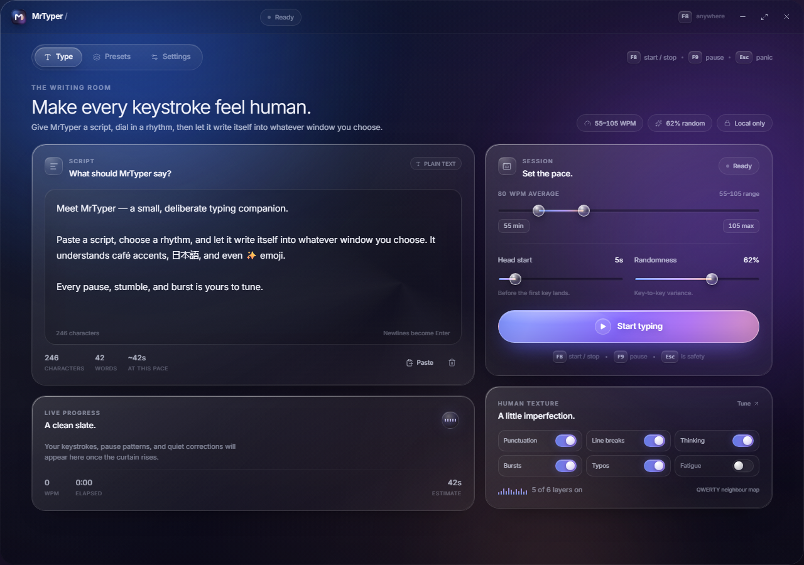
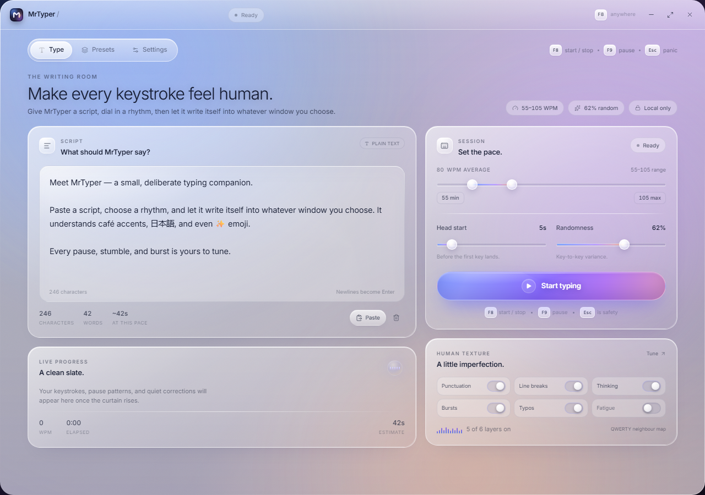

# MrTyper

**A human-paced typing companion for Windows.** Paste a script, tune the rhythm, and let MrTyper type it into whatever window you focus — with deliberate pauses, occasional corrections, and a softly glowing glass interface.



<details>
<summary>Light theme preview</summary>



</details>

## Why MrTyper?

Most text expanders paste. MrTyper *performs*. Every character travels through the Windows `SendInput` API with `KEYEVENTF_UNICODE`, so accents, right-to-left scripts, CJK, and emoji arrive as real keystrokes. A randomized timing plan gives each run its own cadence, while the engine remains fully interruptible.

Everything lives on your machine. There are no accounts, analytics, network calls, or cloud sync.

## Features

- **Any window, any text.** Unicode input through `SendInput` / `KEYEVENTF_UNICODE`, including emoji and multi-script text.
- **Human cadence.** A dual-handle WPM range (10–300), keystroke randomness, punctuation and line-break pauses, thinking pauses, burst typing, QWERTY typo-and-correct behavior, and optional fatigue drift.
- **Head start.** A 1–30 second animated countdown lets you click into the target application.
- **Global controls.** Start/stop and pause/resume hotkeys work while MrTyper is in the background. Both are rebindable.
- **Live telemetry.** Spring-smoothed effective WPM, characters delivered, elapsed time, ETA, a shimmering progress bar, and a key-tap ripple.
- **Safety net.** Global <kbd>Esc</kbd> kills injection instantly. MrTyper can also stop automatically when focus leaves the target window.
- **Presets.** Save, load, rename, and delete named performance profiles. Three starter profiles are included: *Fast & clean*, *Careful*, and *Sloppy*.
- **Persistent and private.** Text, settings, presets, and window position are stored in one local JSON file.
- **Tray resident.** Closing the window hides it to the system tray, where quick start/stop and pause actions remain available.
- **Liquid glass UI.** Frameless 24px window, Mica/Acrylic backdrop, cursor-following specular light, spring physics, shared-layout tabs, and system light/dark themes.
- **Reduced motion aware.** MrTyper follows Windows' "Reduce motion" preference.

## Stack

| Layer | Choice |
| --- | --- |
| Shell | [Tauri 2](https://v2.tauri.app/) |
| UI | React 19 + TypeScript + Tailwind CSS 4 |
| Motion | Framer Motion (spring physics) |
| Native engine | Rust, one dedicated worker thread per session |
| Keystrokes | Win32 `SendInput` with `KEYEVENTF_UNICODE` |
| Global keys | `tauri-plugin-global-shortcut` |
| Installer | NSIS via Tauri bundler |
| Storage | Versioned JSON in the app config directory |

### Project layout

```
src/                       React application
  pages/                   Type, Presets, Settings
  components/              Glass primitives, title bar, sliders, toasts, countdown
  lib/                     Tauri bridge + browser preview + helpers
src-tauri/
  src/engine.rs            Typing planner, worker loop, event streaming, tests
  src/input.rs             SendInput + foreground-window detection
  src/settings.rs          Settings model, defaults, preset blueprints
  src/store.rs             Atomic JSON persistence + preset CRUD
  src/hotkeys.rs           Global shortcut registration and dispatch
  src/tray.rs              System tray and menu
  src/commands.rs          Tauri command surface
  src/lib.rs               App setup and window lifecycle
  icons/                   Generated app icon set
public/logo.svg            Glass mark used in-app
scripts/generate_icons.py  Rebuilds icon sizes from icon.png
scripts/generate_installer_art.py  Rebuilds branded NSIS bitmaps
docs/                      README screenshots
```

## Requirements

- Windows 10 (1809+) or Windows 11, x64.
- [WebView2 Runtime](https://developer.microsoft.com/microsoft-edge/webview2/) — present by default on Windows 11 and modern Windows 10. The installer can bootstrap it.
- Node.js 20.19+ (or 22.12+) and pnpm 10+.
- Rust stable 1.90+ with the `x86_64-pc-windows-msvc` toolchain.
- Visual Studio 2022 Build Tools with the **Desktop development with C++** workload, plus the Windows 10/11 SDK. See the [Tauri Windows prerequisites](https://v2.tauri.app/start/prerequisites/#windows).

## Run

```powershell
pnpm install
pnpm tauri:dev
```

`pnpm tauri:dev` starts Vite and the native app together. The first Rust build downloads and compiles the Tauri dependency graph, so it can take several minutes.

For UI-only work, run `pnpm dev` in a browser. The app automatically uses a localStorage-backed mock engine at `http://localhost:1420`; it is a design preview and **does not inject keystrokes**.

## Build a single installer

```powershell
pnpm tauri:build
```

Two useful artifacts are produced:

- `src-tauri/target/release/mrtyper.exe` — the standalone app.
- `src-tauri/target/release/bundle/nsis/MrTyper_1.0.0_x64-setup.exe` — the single NSIS installer.

The installer is configured for a per-user install (`currentUser`) and does not require a separate runtime installer. If WebView2 is missing, Tauri's silent bootstrapper downloads it during installation. The binary is unsigned by default; Windows SmartScreen or antivirus heuristics may warn about or quarantine the NSIS installer. The application is built entirely from the source in this repository and makes no network requests at runtime. For distribution, sign the executable and installer with a code-signing certificate.

### Rebuild the icons

Replace `src-tauri/icons/icon.png` and run:

```powershell
python scripts/generate_icons.py
python scripts/generate_installer_art.py
```

The first script regenerates the PNG sizes and multi-resolution `.ico` used by the installer, executable, and tray. The second rebuilds the branded NSIS header and welcome-sidebar images from the same glass artwork.

## Using MrTyper

1. Paste or write a script on the **Type** tab.
2. Choose a WPM range, randomness, and head start. Fine-tune pauses and imperfections on the **Settings** tab.
3. Press **Start typing** (or <kbd>F8</kbd> from anywhere).
4. During the countdown, click into the app where the text should land.
5. MrTyper types the plan into that window. <kbd>F9</kbd> pauses/resumes; <kbd>F8</kbd> stops.
6. <kbd>Esc</kbd> is the emergency stop. While a session is live, MrTyper registers Esc globally only for this purpose; it is released afterwards.

### Default shortcuts

| Action | Default |
| --- | --- |
| Start / stop | <kbd>F8</kbd> |
| Pause / resume | <kbd>F9</kbd> |
| Emergency stop | <kbd>Esc</kbd> |
| Instant stop | The **Stop** button or the tray menu |

Both primary shortcuts are rebindable in **Settings → Global controls**. Use a function key or a modifier chord. Escape is reserved for safety.

### Tray behavior

Closing the window hides MrTyper to the notification area. The tray menu offers **Open MrTyper**, **Start / stop typing**, **Pause / resume**, and **Quit MrTyper**. Use **Quit** when you want the process to end; using the window close button intentionally keeps it available for global hotkeys.

## Installation troubleshooting

### “Error opening file for writing” during setup

If the setup was started by a low-integrity shell, file viewer, or sandboxed agent UI, Windows may give the installer a restricted token. That token cannot create files under `%LOCALAPPDATA%\MrTyper`, so NSIS reports an error opening `mrtyper.exe`.

Close the setup with **Abort**, then launch it with normal rights:

- Right-click the setup executable and choose **Run as administrator**, or
- Launch it from an elevated PowerShell window.

For a setup built from source, the relevant path is `src-tauri\target\release\bundle\nsis\`. This avoids relying on a machine-specific absolute path.

If the installer was previously running, make sure it has fully closed first (check Task Manager for `MrTyper_1.0.0_x64-setup`).

## Configuration and privacy

On Windows the JSON state is written under the per-user Roaming AppData directory:

```
%APPDATA%\com.mrtyper.desktop\mrtyper.json
```

It contains settings, presets, the last script, and remembered window bounds. Writes are atomic (temp file + rename), and a corrupt file is backed up rather than overwritten silently. WebView2 keeps its own browser cache under `%LOCALAPPDATA%\com.mrtyper.desktop\webview2`.

For isolated development/testing, two environment overrides are available: `MRTYPER_CONFIG_DIR` changes where the settings JSON lives and `MRTYPER_WEBVIEW_DIR` changes the WebView2 profile directory.

MrTyper makes no network requests at runtime. The only optional network activity happens at install time if the WebView2 bootstrapper must be downloaded.

## Security notes

- **Same privilege level.** Windows UIPI prevents a standard user process from injecting into elevated applications. Run MrTyper at the same elevation as the target if necessary.
- **Focus guard.** For safety, MrTyper refuses to begin if it still owns focus when the countdown ends, and can stop when another window takes focus. Disable *Stop when focus leaves* only if you understand the trade-off.
- **Emergency stop is global but temporary.** The Esc shortcut is registered only while a session is active.
- **No persistence of keystrokes.** The target application receives the text; MrTyper only keeps the script you chose to remember in its local config.

## Testing

Rust tests cover the human timing distribution, punctuation pauses, hotkey validation, JSON persistence, preset uniqueness, text normalization, and QWERTY typo logic:

```powershell
cargo test --manifest-path src-tauri/Cargo.toml
```

The pure engine tests exercise the same code path used by the typing worker: 600-key delay sampling inside the WPM envelope, zero-randomness steadiness, increasing variance, punctuation and line-break pauses, thinking-pause accounting, Unicode text handling, WPM bounds, and QWERTY neighbor/case-preserving typo generation.

Frontend type checking and production build:

```powershell
pnpm build
```

The compiled page is a static bundle; no browser is needed at runtime beyond the installed WebView2 runtime.

## Implementation notes

- The engine precomputes a timing plan so ETA stays stable even through punctuation and thinking pauses.
- Timers are interruptible at 8 ms granularity. Every keystroke and pause checks cancellation and pause state.
- Unicode characters are encoded as UTF-16 code units and sent as `KEYEVENTF_UNICODE` down/up pairs; newlines use `VK_RETURN`, tabs use `VK_TAB`, and typo corrections use `VK_BACK`.
- The timing plan never runs on the UI thread. Tauri commands and progress events are the only bridge between the worker and React.
- `pnpm dev` uses the browser mock in `src/lib/mockBackend.ts`. The packaged application always uses the native Rust engine.

## License

MIT. See [LICENSE](LICENSE).
